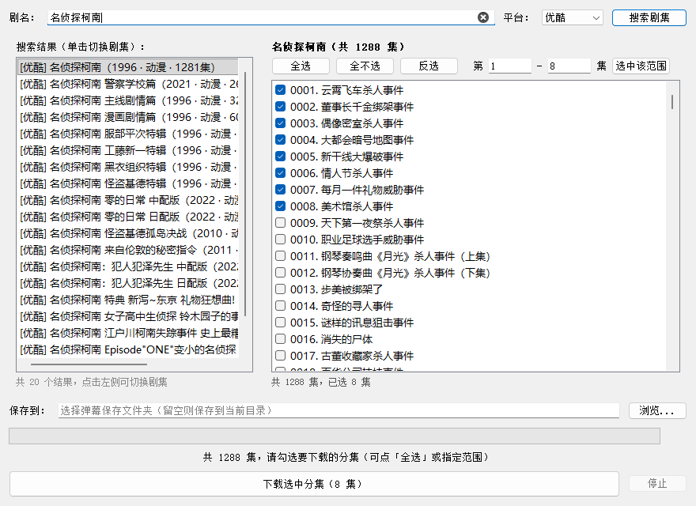

# DanmuTools 弹幕下载工具

🎬 **DanmuTools** 是一个支持多平台弹幕抓取的桌面工具，适用于视频分析、弹幕可视化、评论研究等场景。现已支持 **爱奇艺、哔哩哔哩（B站）、优酷、腾讯视频** 四大主流平台。

界面按常见视频 App 的习惯组织：**搜剧名 → 选集 → 下载**，不需要再去网页上复制视频链接，也可以只下载其中几集。

## 支持平台

| 平台 | 单集/选集下载 | 全集枚举 | 按剧集名称搜索 |
| --- | :---: | :---: | :---: |
| 爱奇艺（iqiyi.com） | ✅ | ✅ | ✅ |
| 哔哩哔哩（bilibili.com） | ✅ | ✅ | ✅ 番剧/纪录片 + 普通视频 |
| 优酷（youku.com） | ✅ | ✅ | ✅ |
| 腾讯视频（v.qq.com） | ✅ | ✅ | ✅ |

> B站除了番剧/影视，**普通投稿视频**（BV 号）也能搜到：单P视频直接下该视频弹幕，多P视频自动展开成各分P，按集勾选下载。
>
> 各平台的搜索会收录其他平台的内容（例如在优酷搜「龙族」会看到腾讯的剧、在爱奇艺搜「龙族」会看到 `外站播放` 的卡片）。这类卡片本平台没有分集和弹幕，程序已自动过滤。

## 功能特色

- **不用输链接**：输入剧名即可搜索，候选列表显示平台、年份、类型、集数
- **按需选集**：左侧选剧集，右侧勾选分集；支持「全选 / 全不选 / 反选」，也可直接填「第 3 到第 8 集」批量选中
- 短剧（≤50 集）默认全选，长剧默认不选，避免误下上千集
- 全集自动枚举分集，逐集下载并按集保存；单集失败不会中断整个任务
- 弹幕导出为标准 XML（兼容 Bilibili 本地播放器）
- 图形化界面（基于 PyQt5），抓取任务多线程执行，界面流畅不卡顿

> **分集枚举实现说明**：
> - 腾讯视频：通过 `PageServer/GetPageData` 分集列表接口枚举，自动跳过预告片、识别预约中剧集；
> - 优酷：从开放 API `shows/videos.json` 分页枚举；
> - 爱奇艺：以专辑 ID 调 `tvg/v2/selector` 枚举；
> - B站：番剧走 `pgc/view/web/season`；普通视频/UP 主分P合集走 `web-interface/view`（搜索时 `search_type=media_bangumi`、`search_type=media_ft`（电影/电视剧/纪录片）与 `search_type=video` 都会查）。
>
> 若某平台接口临时变动导致枚举失败，界面会提示「分集加载失败」，可换一个候选剧集或换平台重试。

## 安装依赖

建议使用 Python 3.9 及以上版本，并推荐虚拟环境：

```bash
pip install -r requirements.txt
```

## 使用方法

### 启动图形界面

```bash
python main.py
```



### 操作流程

1. 顶部输入剧名（如 `名侦探柯南`、`狂飙`、`龙族`），选择平台（选具体平台更快；保留「自动检测」则四平台一起搜），点 **搜索剧集**
2. 左侧点选目标剧集，右侧会加载该剧全部分集
3. 勾选要下载的分集：
   - 点 **全选 / 全不选 / 反选**
   - 或在「第 __ 至 __ 集」里填范围后点 **选中该范围**
4. 选择保存路径，点 **下载选中分集（N 集）**，进度与状态实时显示，随时可 **停止**
5. 结果保存在 `保存路径/剧名/NN_集标题.xml`

## 项目结构
```
DanmuTools/
├── main.py                  # 主程序入口
├── core/
│   ├── base.py              # BaseFetcher 抽象类（选集下载通用流程、搜索解析）
│   ├── search.py            # 四平台剧集搜索与候选排序
│   ├── bilibili.py          # B站弹幕抓取器（番剧/普通视频/分P合集）
│   ├── iqiyi.py             # 爱奇艺弹幕抓取器
│   ├── tencent.py           # 腾讯视频弹幕抓取器
│   ├── youku.py             # 优酷弹幕抓取器
│   └── utils.py             # 工具函数（XML 导出）
├── ui/
│   └── main_window.py       # 主窗口（搜索 / 选集 / 下载）
└── README.md
```

## 开发说明

- 所有弹幕抓取器均继承自 `BaseFetcher`，实现统一接口：`extract_video_id()`、`get_video_info()`、`_run_single()`、`enumerate_episodes()`、`_fetch_episode(ep)`
- 选集下载由 `BaseFetcher._run_series()` 调度：界面传入用户勾选的 `episodes` 时直接使用，否则调用 `enumerate_episodes()` 枚举后逐集下载
- 名称搜索由 `core/search.py` 统一实现：各平台搜索接口 → `sort_results()` 按标题匹配度排序（并跳过预约中/无分集的条目）
- 腾讯视频：分集与时长来自 `GetPageData`，弹幕按 30 秒分段拉取
- 优酷：纯 `requests` 获取 `_m_h5_tk` token 并签名请求弹幕接口，**不依赖 Selenium / Chrome**
- 爱奇艺：分集通过 `tvg/v2/selector`（按 key 排序 + md5 签名）获取，弹幕按 300 秒一段的 `.z` 文件分段请求
- 图形界面基于 PyQt5，搜索与分集加载、下载各用独立 QThread，保证界面不卡顿

## License

本项目仅供学习和研究使用，禁止商业用途。详情见 LICENSE 文件。

---
