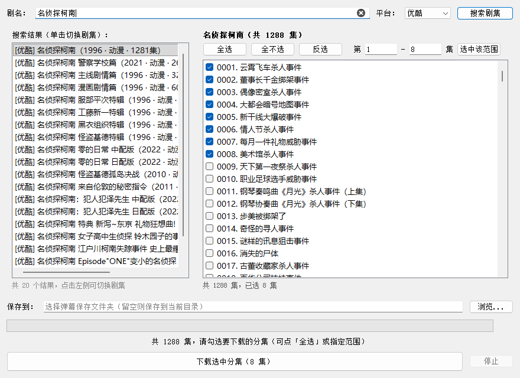

# DanmuTools 更新说明

> 桌面端多平台弹幕下载工具（PyQt5），支持爱奇艺、腾讯视频、哔哩哔哩、优酷。
> 本次更新日期：2026-11-25

---

## 一、界面重做：搜剧名 → 选集 → 下载

原来的流程是「复制链接 → 粘贴 → 选平台 → 下载」，对只想下几集的人太绕。本次按常见视频 App 的习惯重做界面：

1. 顶部输入剧名 → 点「搜索剧集」，左侧列出候选（`[平台] 剧名（年份 · 类型 · 集数）`）；
2. 点选某部剧，右侧自动加载全部分集；
3. **勾选要下载的几集**：支持「全选 / 全不选 / 反选」，也可以填「第 3 至第 8 集」一键选中范围；
4. 选保存路径，点「下载选中分集（N 集）」，进度、状态实时显示，随时可停止。

- **链接下载方式已移除**：剧名搜索更贴近使用习惯，也绕开了各平台播放页链接结构频繁变动的问题；
- 短剧（≤50 集）默认全选，长剧（如 1288 集）默认不选，避免误点下载上千集；
- 分集列表按集号补零显示（`0001. 云霄飞车杀人事件`），保存文件名同样补零对齐；
- 搜索结果里「预约中」的剧集会被标注，并自动跳过无分集的候选。

---

## 二、四平台分集枚举（保留并优化）

| 平台 | 分集枚举方式 | 实测 |
| --- | --- | --- |
| 腾讯视频 | `PageServer/GetPageData`（`vsite_episode_list`）分页拉取 `item_params`，跳过预告片 | 「龙族 第2季」24 集 |
| 爱奇艺 | 专辑 ID → `tvg/v2/selector`（md5 签名）展开 `feature_paged` | 「名侦探柯南」1281 集 |
| 优酷 | `openapi/v2/shows/videos.json` 分页 | 「名侦探柯南」1288 集 |
| 哔哩哔哩 | 番剧 `pgc/view/web/season`、分P `web-interface/view` | 「名侦探柯南」1284 集 |

- 剧集搜索接口：腾讯 `HttpMobileRecall/MbSearchHttp`、优酷 `search.youku.com/api/search`、爱奇艺 `homePageV3`、B站 `search/type?search_type=media_bangumi` 与 `search_type=video`；
- **B站普通投稿视频也能搜到**：单P视频直接取该视频弹幕，多P（合集/分P）自动展开成各分集，勾选后逐集保存；
- 候选排序优先「完全匹配、已开播、有分集信息」的剧集，避免选中预约占位季（搜「龙族」不再误选第3季）；
- 单集失败不中断整个任务，结束时提示失败集数；枚举不到分集时提示换剧集或换平台。

---

## 三、问题修复

| 问题 | 修复内容 |
| --- | --- |
| 保存路径无目录时崩溃 | `save_as_bilibili_xml` 增加空目录判断，仅在存在目录部分时 `makedirs` |
| 优酷单集下载无法中止 | 移除 `_fetch_episode` 中硬编码的 `self.running = True`，改用统一的 `check_stop()` |
| 爱奇艺取 tvid 不可靠 | 改为「先枚举专辑分集，再按 vid 匹配当前集」 |
| 全集任务中某集失败导致整个任务报错 | `_run_series()` 记录失败集数并继续 |
| B站搜索返回 412 | 搜索前请求 `finger/spi` 获取 `buvid3/buvid4`，并带 `Referer` 重试 |
| 腾讯「预约中」剧集枚举为空 | 搜索结果识别 `status=1`／「预约」标签并降权 |
| 停止下载后线程仍继续请求 | 各平台请求循环统一走 `check_stop()`，`stop()` 等待线程退出 |
| 优酷分集标题全是剧名 | 标题重复时自动改为「第N集」 |
| 分集文件名重复编号（`03_3 偶像密室杀人事件.xml`） | 集标题自带集号时剥离前缀 |
| 搜不到 B站普通视频 | B站搜索同时查 `media_bangumi` 与 `video`，普通视频按 BV 号下载、多P 自动展开 |
| 所选分集全无弹幕时提示含糊（“已保存 0 集”） | 改为提示「所选分集暂无弹幕」，并说明可能已关闭弹幕/未生成 |

---

## 四、其他

- 移除 `requirements.txt` 中已不再使用的 `playwright` 依赖；
- 新增 `core/search.py`，搜索逻辑与下载逻辑解耦；
- `BaseFetcher` 支持直接传入用户勾选的 `episodes`，跳过二次枚举；
- 打包配置见 `package.py`（`PyInstaller` 单文件打包）。

---

*如果你发现某个平台接口失效或下载异常，欢迎在 GitHub 提交 Issue 反馈。*
